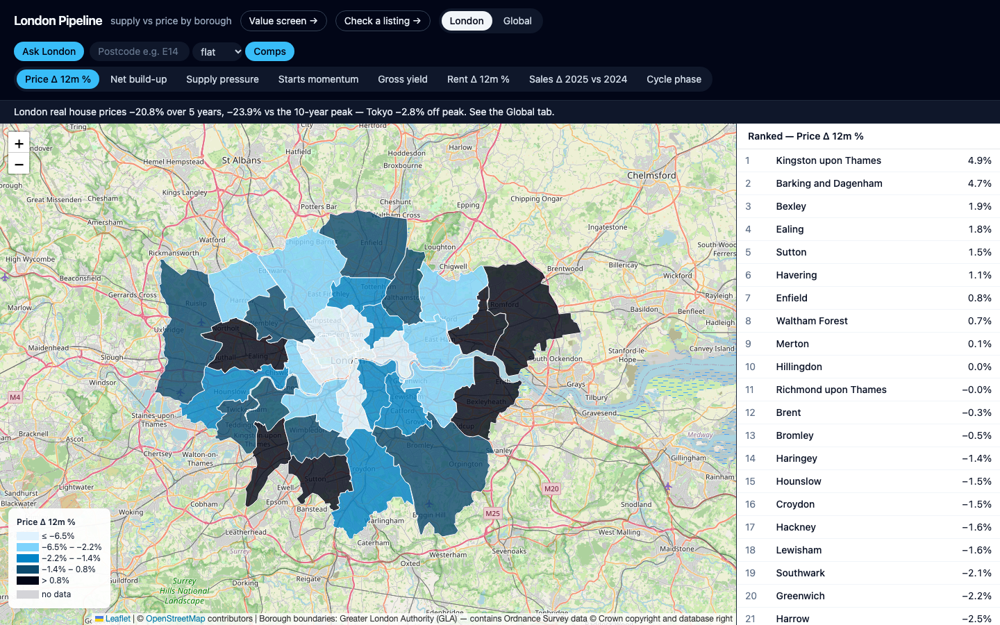
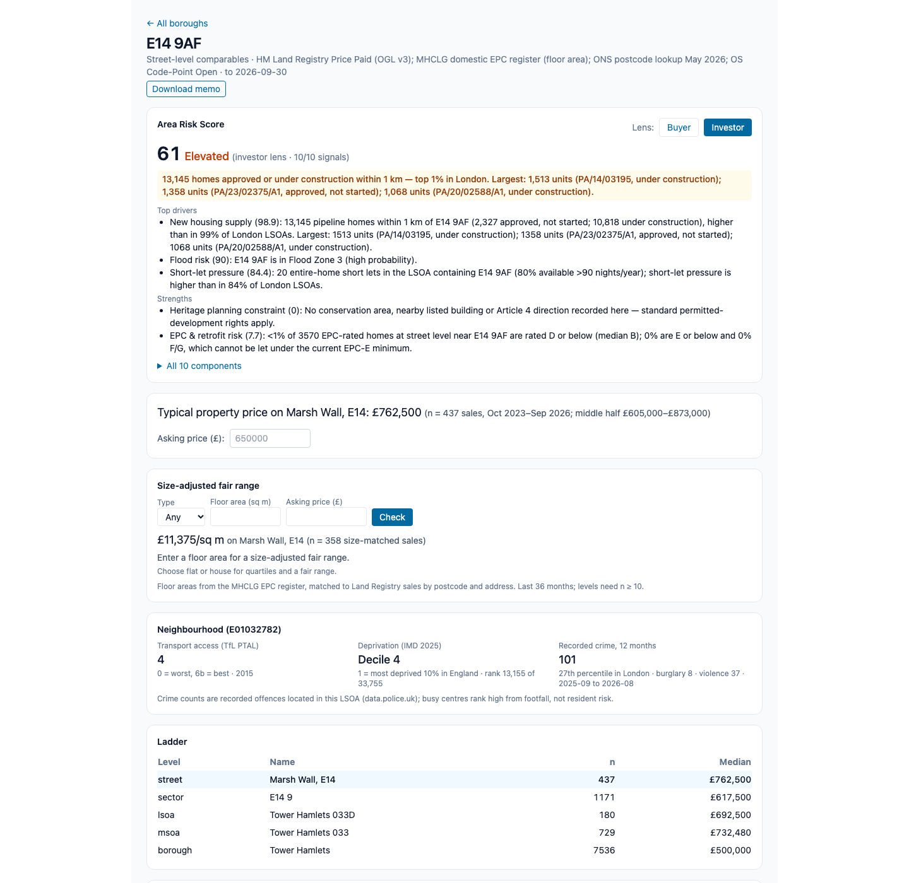
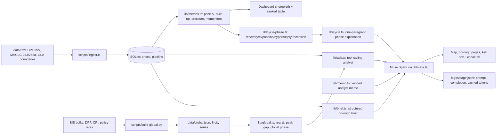

# London Pipeline

**Live demo:** https://london-pipeline.fly.dev · Built solo for the Meta Global AI Developer Hackathon (Indie track).

London's housing supply data is public but scattered — Land Registry prices in one place, MHCLG starts and completions in another, boundaries somewhere else — so nobody can see at a glance where the construction pipeline is building up and could weigh on prices. London Pipeline puts all 33 boroughs on one map with an analyst you can question: borough cycle phases, street-level fair prices from 4.6 million EPC-matched sales, a value-vs-momentum screen, a 10-signal Area Risk Score with buyer and investor lenses, and analyst memos with every figure verified against source data.





## Built during the hackathon

Built 26 Oct to 4 Nov 2026 for the Meta AI Developer Hackathon. All code in this repo was written during the event (first commit: 2026-10-30). The public datasets listed under [Data sources and licences](#data-sources-and-licences) were downloaded and processed during the event.

> For information only. Not financial, investment or property advice. Figures are estimates from public data and may be wrong.

## What it does

- Borough cycle map: 33-borough choropleth (price change, pipeline build-up, supply pressure, starts momentum, yield, cycle phase) with a ranked table.
- Ask London: plain-English questions answered by a tool-calling analyst over borough, street, global and risk data, with a figure verifier. Includes borough approvals: "Which boroughs have the most units approved but not started?" ranks boroughs on Planning London Datahub counts.
- Street comps + fair range (`/area/[postcode]`): size-adjusted £/sq m fair range with a street → borough fallback ladder and repeat-sales momentum.
- Value screen (`/screen`): LSOAs ≥10% below their borough on £/sq m where MSOA momentum beats the borough, with transport and deprivation filters.
- Area Risk Score: one 0–100 score per postcode from 10 context signals, buyer/investor lens toggle, supply-pressure callouts.
- Analyst memo: structured call with evidence, risks and what-would-change-it, badge-verified figure by figure; download from any borough or area page.

## How Muse Spark is used

All model calls go through one wrapper, `lib/meta.ts` (OpenAI SDK against `META_BASE_URL`, model `muse-spark-1.3`), which logs prompt, completion and cached tokens per call to `logs/usage.jsonl` and serves fixtures under `MOCK_META=1`.

- Ask London (`prompts/ask.md`): six tools — `list_boroughs`, `get_borough_metrics`, `rank_boroughs`, `get_city_metrics`, `get_area_comps`, `get_area_risk` — then a 2–3 sentence answer citing only returned numbers; a verifier rechecks every figure against tool results.
- Borough briefs (`prompts/brief.md`): one borough's metrics in, validated JSON `{headline, supply_view, price_view, risk_flag, confidence}` out (zod, retry-once, graceful fallback).
- Analyst memo (`prompts/memo.md`): one–two boroughs in, one JSON memo out; every figure checked against tool results, "✓ n/m figures verified" badge; market read-across is qualitative only.
- Listing check (`prompts/listing.md`): extracts price, floor area, postcode, type, bedrooms from pasted text (+ optional floorplan image); verdict reuses the fair-range code path.
- Cycle explanation (`prompts/cycle.md`): one paragraph on why a borough maps to recovery / expansion / hypersupply / recession, with a deterministic fallback.

## Data

All open data; see [data/SOURCES.md](data/SOURCES.md) for URLs and build scripts.

| Source | Licence | As of |
|---|---|---|
| HM Land Registry UK House Price Index (borough averages) | OGL v3 | Aug 2026 |
| MHCLG Live Tables 253 (annual) + 253a (quarterly) starts/completions | OGL v3 | FY 2025-26 / Q2 2026 |
| GLA statistical GIS boundaries (maps carry the GLA copyright notice) | GLA | 2011 |
| ONS Price Index of Private Rents (City of London suppressed → null) | OGL v3 | Sep 2026 |
| HM Land Registry Price Paid 2024–2025 London extract (volumes, new-build share) | OGL v3 | 2025 |
| Price Paid 2016–Sep 2026 + ONS postcode lookup + OS Code-Point Open (street build) | OGL v3 | Sep 2026 |
| MHCLG domestic EPC register, 4.6m London certificates matched to sales (90.1%) | OGL v3 | Dec 2026 |
| IMD 2025 deprivation; TfL PTAL 2015 transport access; police.uk street crime | OGL v3 / TfL open data | 2025 / 2015 / Sep 2025–Aug 2026 |
| Environment Agency Flood Map for Planning (flood zones) | OGL v3 | Aug 2023 |
| GLA/TfL London Atmospheric Emissions Inventory 2022 (air) | OGL v3 | 2022 |
| Defra strategic noise mapping Round 4, road + rail (noise) | OGL v3 | 2022 |
| DfE GIAS + Ofsted (schools) | OGL v3 | Oct 2026 / Sep 2026 |
| TfL open data + PTAL (transport); OS Open Greenspace (greenspace) | TfL open data / OS Open Data | Sep 2026 / Nov 2026 |
| planning.data.gov.uk conservation/listed/article-4 (heritage) | OGL v3 | Nov 2026 |
| Inside Airbnb London listings (short lets) | CC BY 4.0 | Sep 2026 |
| Planning London Datahub guest API approvals (pipeline) | GLA | Nov 2026 |
| BIS house prices + CPI + policy rates (8 global cities) | BIS | to Sep/Oct 2026 |

## Run locally

```bash
npm install
MOCK_META=1 npm run dev   # open http://localhost:3000, zero model spend
```

Live (Meta Muse Spark):

```bash
cp .env.example .env   # add MODEL_API_KEY, keep META_BASE_URL + META_MODEL
npm run dev
```

Checks: `npx tsc --noEmit` · `MOCK_META=1 npx vitest run --cache=false` (24 files, 172 tests) · `npm run build`

## Limits

- The screen is a starting list, not a valuation; repeat-sales momentum is MSOA-level, not street-level.
- Risk scores are within-London bands, not absolute risk; postcodes with different signal coverage are not strictly comparable.
- Prices are averages from source data, not forecasts; missing values show as "no data", never invented.
- Approvals come from the Planning London Datahub (approved decisions 2015 to Sep 2026, as of 1 Nov 2026), not MHCLG. `approvedNotStarted` is reliable; `underConstruction` counts started sites with no completion recorded, and Datahub completion records are patchy, so treat it as an upper bound. There is no approvals time series.
- Supply pressure floors average annual completions at 250 homes a year (about London's lower-quartile borough), so boroughs that complete very few homes don't read as hypersupply off a small pipeline. With the floor, no borough is currently in hypersupply.
- Borough cycle explanations and briefs are recorded live once (`scripts/precompute-cycle.ts`, `scripts/precompute-briefs.ts`) and reused only while their exact inputs still match, so pages load instantly; delete `data/demo-cache/{cycle,briefs}.json` to generate live again.

## Architecture



## How we use Meta models

All calls go through one wrapper, `lib/meta.ts` (OpenAI SDK against `META_BASE_URL`, model `muse-spark-1.3`), which logs prompt, completion and cached tokens per call to `logs/usage.jsonl` and supports `MOCK_META=1` fixtures so the UI and tests run without spending credits.

- **Ask London (tool-calling analyst agent):** borough metrics include `approvedNotStarted` and `underConstruction` from the Planning London Datahub (`scripts/context/pipeline/build_borough.py`, sites assigned to boroughs by point-in-polygon). The model gets six tools — `list_boroughs()`, `get_borough_metrics(code)`, `rank_boroughs(metric, n, order)`, `get_city_metrics(city)`, `get_area_comps(postcode, …)`, `get_area_risk(postcode, lens)` — over SQLite plus the BIS global snapshot. It calls tools, then answers in 2–3 sentences citing only returned numbers; if the data isn't there, it says so. Prompts: `prompts/ask.md`.
- **Structured borough briefs:** each borough page generates a validated JSON card `{headline, supply_view, price_view, risk_flag, confidence}` from that borough's metrics only (`prompts/brief.md`, zod-validated, retry-once then graceful fallback).
- **Verified analyst memo:** one or two boroughs in, one JSON memo out (`prompts/memo.md`, zod-validated). Every figure is checked against tool results and the card shows a "✓ n/m figures verified" badge; the qualitative market read-across must contain no numbers.
- **Global view:** eight capitals/cities from BIS residential property prices, deflated with national CPI into real indices, against policy rates. A rule-based phase (expansion / cooling / correction / recovery) comes from real-price momentum × rate direction. Supply data isn't comparable across cities, so this view is prices and rates only.
- **Street-level comps:** Ask London also has a `get_area_comps(postcode, type, price, sqm)` tool over `data/street.db`. See "Street level" below.
- **Cycle explanation:** a rule-based classifier maps 12-month price change × supply pressure to recovery / expansion / hypersupply / recession; Muse Spark explains the borough's phase in one paragraph (`prompts/cycle.md`), with a deterministic fallback when the model is unavailable.

## Street level

Borough averages hide a lot. The street-level layer answers "is this price fair for this flat?" at postcode level, and finds neighbourhoods that look cheap and are starting to move.

- **Size-adjusted fair range (`/area/[postcode]`):** EPC floor areas turn each sale into £ per sq m by street, so a 70 sq m flat is compared with like-sized sales rather than the street's average price. 4.6m London EPC certificates are matched to Price Paid sales (90.1% matched). Comps use the last 36 months of sales (to Sep 2026); the repeat-sales history runs from 2016. Where a street has too few sales the page falls back street → sector → LSOA → MSOA → borough, using the first level with n ≥ 10. Momentum is a repeat-sales index: the same homes resold, new builds excluded.
- **Value vs momentum screen (`/screen`):** lists LSOAs priced at least 10% below their borough £ per sq m, where the MSOA's repeat-sales momentum is above the borough's (MSOA needs at least 150 repeat-sale pairs). One row per MSOA, each linked to its area comps. 52 MSOAs qualify; ticking "Good transport (PTAL 3+)" and "Exclude most deprived 20%" cuts that to 30. The top result is SE12 9 (Lewisham): -26% against the borough on £ per sq m, +11.1% over one year against -0.3% for the borough. The result is cached (about 0.02s).
- **Neighbourhood card (`/area/[postcode]`):** per LSOA, IMD 2025 deprivation decile, TfL PTAL 2015 transport access, and police.uk crime for Sep 2025 to Aug 2026.
- **Check a listing (`/check`):** paste listing text (and optionally a floorplan image) and Muse Spark extracts price, floor area, postcode, type and bedrooms (`prompts/listing.md`, zod-validated). Sq ft to sq m is converted in code, and a floor area or postcode not in the pasted text is dropped, not guessed. The verdict reuses the size-adjusted fair range; with no floor area it falls back to unadjusted comps and says so. Paste only: no scraping of listing sites.
- **Ask London:** the postcode tool returns the fair range, percentile and neighbourhood context, and the number verifier checks every figure in the answer. Demo question: "Is £650k fair for a 70 sq m flat at SE15 4AN?" The recorded answer (`logs/usage.jsonl`) gives a size-adjusted fair range of £587,000 to £789,000 for Copleston Road, with £650,000 at the 58th percentile of recent flat sales. A live run verified 9/9 figures.

Caveats: the screen is a starting list, not a valuation. Repeat-sales momentum is measured at MSOA level, not street level, and EPC matching covers 90.1% of sales, so the rest drop out of £ per sq m.

## Area Risk Score

Every area page (`/area/[postcode]`) shows one 0–100 score (0 best, 100 worst) built from 10 context signals, with a Buyer/Investor lens toggle (`?lens=`) and an API at `/api/area-score?postcode=&lens=`.

| Signal | Source (licence) | As of |
|---|---|---|
| Flood risk | Environment Agency Flood Map for Planning via planning.data.gov.uk (OGL v3) | Aug 2023 |
| Air quality | GLA/TfL London Atmospheric Emissions Inventory 2022 (London Datastore) | 2022 |
| Noise | Defra strategic noise mapping Round 4, road + rail (OGL) | 2022 |
| Schools | DfE GIAS + Ofsted (OGL) | Oct 2026 / Sep 2026 |
| Transport proximity | TfL open data (Elizabeth line stops) + PTAL 2015 | Sep 2026 |
| Greenspace | OS Open Greenspace (OS Open Data licence) | Nov 2026 |
| Heritage | planning.data.gov.uk conservation/listed/article-4 (OGL v3) | Nov 2026 |
| EPC / MEES risk | MHCLG domestic EPC register (OGL v3) | Dec 2026 |
| Short lets | Inside Airbnb London listings (CC BY 4.0) | Sep 2026 |
| Development pipeline | Planning London Datahub guest API (GLA) | Nov 2026 |

Method: overall score is the weighted mean of available component scores, rounded; missing signals are dropped (reweighted). Buyer lens weighs flood 2 and schools 1.5 highest; investor lens weighs pipeline 2, short lets and EPC 1.5. Bands: Low <33, Moderate 33–55, Elevated 55–70, High >70. Under 5 of 10 signals there is no band ("low coverage"). Top drivers are the 3 largest weight×score contributions; top 2 strengths the lowest scores. When the pipeline signal is ≥90th percentile the card shows a supply-pressure callout with the largest schemes. `transport-premium` is excluded (sales data starts Oct 2023, no pre-2022 baseline); postcodes without coordinates show "postcode not located".

Limits: scores are within-London percentiles/bands, not absolute risk; postcodes with different coverage are not strictly comparable. Flood zones are Aug 2023; PTAL underlies access at 2015. Ask London quotes the score only via the `get_area_risk` tool, and the number verifier checks every figure. The `/screen` Risk column and filters (max score, exclude Flood Zone 3) read a precomputed per-LSOA index (`data/context/area-score-lsoa.json`, rebuilt with `scripts/build-area-score-lsoa.ts`) because live-scoring all rows costs ~3s.

## Data sources and licences

Sources (OGL v3, pulled 30 Oct 2026; see [data/SOURCES.md](data/SOURCES.md)):

- Prices: HM Land Registry UK House Price Index, monthly to Aug 2026.
- Starts/completions: MHCLG Live Tables 253 (annual FY) and 253a (quarterly), permanent dwellings by district.
- Boundaries: GLA statistical GIS boundaries (2011).
- Rents: ONS Price Index of Private Rents, monthly to Sep 2026 (City of London suppressed → null). Gross yield = 12 × rent ÷ price; price-to-rent = price ÷ annual rent.
- Sales: Land Registry Price Paid, calendar 2025 vs 2024 volumes and new-build share.
- Street-level comps: `data/street.db`, built by `scripts/street/run_all.sh` (see [data/SOURCES.md](data/SOURCES.md) "Street-level data"). Inputs: Land Registry Price Paid 2016 to Sep 2026; MHCLG domestic EPC register (4.6m London certificates, floor areas); IMD 2025; TfL PTAL 2015; police.uk street crime, Sep 2025 to Aug 2026.
- Global cities: BIS detailed residential property prices + long CPI + policy rates (pulled 30 Oct 2026; London, Paris, Berlin, Tel Aviv, Toronto, Sao Paulo, Sydney, Tokyo).

Attribution:

- Contains HM Land Registry data © Crown copyright and database right 2026. This data is licensed under the Open Government Licence v3.0.
- Contains OS data © Crown copyright and database right 2026
- Contains Royal Mail data © Royal Mail copyright and Database right 2026
- Contains National Statistics data © Crown copyright and database right 2026
- Powered by TfL Open Data
- Short-let listings: Inside Airbnb (insideairbnb.com), licensed CC BY 4.0.
- Global city prices, CPI and policy rates: Bank for International Settlements (BIS) data portal, data.bis.org.
- EPC data is used only in aggregate (£/sq m by area); no address-level EPC records are published.

Limitations:

- **Starts momentum is n/a where the prior 4-quarter base is under 100 homes** (too noisy to annualise).
- **Approvals data is not in this build** (GLA Planning London Datahub needs an access request).
- **Prices are average prices from the source data, not forecasts.**
- **Global city series are nominal**, deflated with national CPI; Paris/Berlin share the euro-area rate; Tel Aviv's 10-year peak uses history from 2017. Supply data isn't comparable across cities.
- Missing values are `null` and show as "no data" — figures are never invented, estimated or interpolated.

## Stack

Next.js (App Router) + TypeScript strict, Tailwind, Leaflet + OpenStreetMap, recharts, zod, SQLite (`better-sqlite3`), Vitest. Model: Muse Spark via the Meta Model API.

## Disclaimer

For information only. Not financial, investment or property advice. Figures are estimates from public data and may be wrong.

## Licence

MIT, see [LICENSE](LICENSE). Data remains under its original licences listed above.
