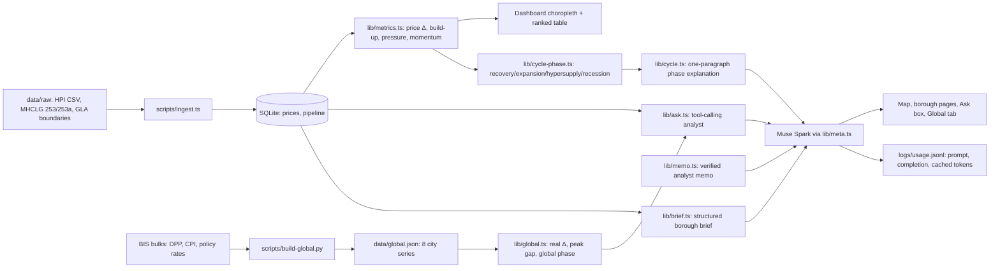

# London Pipeline

See where London's housing construction pipeline is building up or drying out, borough by borough, against prices — and ask about it in plain English.

London supply data is public but scattered across GLA dashboards, planning exports and Land Registry files. A student fund analyst, a small developer or a journalist can't quickly see which boroughs have a large pipeline that could weigh on prices. This puts it on one map, with an analyst you can question.

Live headline (computed from data on load): London house prices are down 20.8% in real terms over five years — 23.9% below their 10-year peak — while Tokyo sits just 2.8% below peak. See the Global tab.

## 30-second quick-start

Mock mode (zero spend):

```bash
npm install
MOCK_META=1 npm run dev   # open http://localhost:3000
```

Live (Meta Muse Spark):

```bash
cp .env.example .env   # add MODEL_API_KEY
npm run dev
```

Checks: `npm run typecheck` · `npm test` (runs with `MOCK_META=1`; 95 tests passing) · `npm run build`

## Architecture



## How we use Meta models

All calls go through one wrapper, `lib/meta.ts` (OpenAI SDK against `META_BASE_URL`, model `muse-spark-1.3`), which logs prompt, completion and cached tokens per call to `logs/usage.jsonl` and supports `MOCK_META=1` fixtures so the UI and tests run without spending credits.

- **Ask London (tool-calling analyst agent):** the model gets four tools — `list_boroughs()`, `get_borough_metrics(code)`, `rank_boroughs(metric, n, order)`, `get_city_metrics(city)` — over SQLite plus the BIS global snapshot. It calls tools, then answers in 2–3 sentences citing only returned numbers; if the data isn't there, it says so. Prompts: `prompts/ask.md`.
- **Structured borough briefs:** each borough page generates a validated JSON card `{headline, supply_view, price_view, risk_flag, confidence}` from that borough's metrics only (`prompts/brief.md`, zod-validated, retry-once then graceful fallback).
- **Verified analyst memo:** one or two boroughs in, one JSON memo out (`prompts/memo.md`, zod-validated). Every figure is checked against tool results and the card shows a "✓ n/m figures verified" badge; the qualitative market read-across must contain no numbers.
- **Global view:** eight capitals/cities from BIS residential property prices, deflated with national CPI into real indices, against policy rates. A rule-based phase (expansion / cooling / correction / recovery) comes from real-price momentum × rate direction. Supply data isn't comparable across cities, so this view is prices and rates only.
- **Street-level comps:** Ask London also has a `get_area_comps(postcode, type, price, sqm)` tool over `data/street.db`. See "Street level" below.
- **Cycle explanation:** a rule-based classifier maps 12-month price change × supply pressure to recovery / expansion / hypersupply / recession; Muse Spark explains the borough's phase in one paragraph (`prompts/cycle.md`), with a deterministic fallback when the model is unavailable.

## Street level

Borough averages hide a lot. The street-level layer answers "is this price fair for this flat?" at postcode level, and finds neighbourhoods that look cheap and are starting to move.

- **Size-adjusted fair range (`/area/[postcode]`):** EPC floor areas turn each sale into £ per sq m by street, so a 70 sq m flat is compared with like-sized sales rather than the street's average price. 4.6m London EPC certificates are matched to Price Paid sales (90.1% matched). Comps use the last 36 months of sales (to Sep 2026); the repeat-sales history runs from 2016. Where a street has too few sales the page falls back street → sector → LSOA → MSOA → borough, using the first level with n ≥ 10. Momentum is a repeat-sales index: the same homes resold, new builds excluded.
- **Value vs momentum screen (`/screen`):** lists LSOAs priced at least 10% below their borough £ per sq m, where the MSOA's repeat-sales momentum is above the borough's (MSOA needs at least 150 repeat-sale pairs). One row per MSOA, each linked to its area comps. 52 MSOAs qualify; ticking "Good transport (PTAL 3+)" and "Exclude most deprived 20%" cuts that to 30. The top result is SE12 9 (Lewisham): -26% against the borough on £ per sq m, +11.1% over one year against -0.3% for the borough. The result is cached (about 0.02s).
- **Neighbourhood card (`/area/[postcode]`):** per LSOA, IMD 2025 deprivation decile, TfL PTAL 2015 transport access, and police.uk crime for Sep 2025 to Aug 2026.
- **Ask London:** the postcode tool returns the fair range, percentile and neighbourhood context, and the number verifier checks every figure in the answer. Demo question: "Is £650k fair for a 70 sq m flat at SE15 4AN?" The recorded answer (`logs/usage.jsonl`) gives a size-adjusted fair range of £587,000 to £789,000 for Copleston Road, with £650,000 at the 58th percentile of recent flat sales. A live run verified 9/9 figures.

Caveats: the screen is a starting list, not a valuation. Repeat-sales momentum is measured at MSOA level, not street level, and EPC matching covers 90.1% of sales, so the rest drop out of £ per sq m.

## Data sources and limitations

Sources (OGL v3, pulled 30 Oct 2026; see [data/SOURCES.md](data/SOURCES.md)):

- Prices: HM Land Registry UK House Price Index, monthly to Aug 2026.
- Starts/completions: MHCLG Live Tables 253 (annual FY) and 253a (quarterly), permanent dwellings by district.
- Boundaries: GLA statistical GIS boundaries (2011).
- Rents: ONS Price Index of Private Rents, monthly to Sep 2026 (City of London suppressed → null). Gross yield = 12 × rent ÷ price; price-to-rent = price ÷ annual rent.
- Sales: Land Registry Price Paid, calendar 2025 vs 2024 volumes and new-build share.
- Street-level comps: `data/street.db`, built by `scripts/street/run_all.sh` (see [data/SOURCES.md](data/SOURCES.md) "Street-level data"). Inputs: Land Registry Price Paid 2016 to Sep 2026; MHCLG domestic EPC register (4.6m London certificates, floor areas); IMD 2025; TfL PTAL 2015; police.uk street crime, Sep 2025 to Aug 2026.
- Global cities: BIS detailed residential property prices + long CPI + policy rates (pulled 30 Oct 2026; London, Paris, Berlin, Tel Aviv, Toronto, Sao Paulo, Sydney, Tokyo).

Limitations:

- **Starts momentum is n/a where the prior 4-quarter base is under 100 homes** (too noisy to annualise).
- **Approvals data is not in this build** (GLA Planning London Datahub needs an access request).
- **Prices are average prices from the source data, not forecasts.**
- **Global city series are nominal**, deflated with national CPI; Paris/Berlin share the euro-area rate; Tel Aviv's 10-year peak uses history from 2017. Supply data isn't comparable across cities.
- Missing values are `null` and show as "no data" — figures are never invented, estimated or interpolated.

## Stack

Next.js (App Router) + TypeScript strict, Tailwind, Leaflet + OpenStreetMap, recharts, zod, SQLite (`better-sqlite3`), Vitest. Model: Muse Spark via the Meta Model API.
