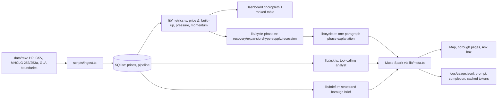

# London Pipeline

See where London's housing construction pipeline is building up or drying out, borough by borough, against prices — and ask about it in plain English.

London supply data is public but scattered across GLA dashboards, planning exports and Land Registry files. A student fund analyst, a small developer or a journalist can't quickly see which boroughs have a large pipeline that could weigh on prices. This puts it on one map, with an analyst you can question.

## 30-second quick-start

Mock mode (zero spend):

```bash
npm install
MOCK_META=1 npm run dev   # open http://localhost:3000
```

Live (Meta Muse Spark):

```bash
cp .env.example .env   # add MODEL_API_KEY
npm run dev
```

Checks: `npm run typecheck` · `npm test` (runs with `MOCK_META=1`) · `npm run build`

## Architecture



## How we use Meta models

All calls go through one wrapper, `lib/meta.ts` (OpenAI SDK against `META_BASE_URL`, model `muse-spark-1.3`), which logs prompt, completion and cached tokens per call to `logs/usage.jsonl` and supports `MOCK_META=1` fixtures so the UI and tests run without spending credits.

- **Ask London (tool-calling analyst agent):** the model gets three tools — `list_boroughs()`, `get_borough_metrics(code)`, `rank_boroughs(metric, n, order)` — over SQLite. It calls tools, then answers in 2–3 sentences citing only returned numbers; if the data isn't there, it says so. Prompts: `prompts/ask.md`.
- **Structured borough briefs:** each borough page generates a validated JSON card `{headline, supply_view, price_view, risk_flag, confidence}` from that borough's metrics only (`prompts/brief.md`, zod-validated, retry-once then graceful fallback).
- **Cycle explanation:** a rule-based classifier maps 12-month price change × supply pressure to recovery / expansion / hypersupply / recession; Muse Spark explains the borough's phase in one paragraph (`prompts/cycle.md`), with a deterministic fallback when the model is unavailable.

## Data sources and limitations

Sources (OGL v3, pulled 30 Oct 2026; see [data/SOURCES.md](data/SOURCES.md)):

- Prices: HM Land Registry UK House Price Index, monthly to Aug 2026.
- Starts/completions: MHCLG Live Tables 253 (annual FY) and 253a (quarterly), permanent dwellings by district.
- Boundaries: GLA statistical GIS boundaries (2011).

Limitations:

- **Starts momentum is n/a where the prior 4-quarter base is under 100 homes** (too noisy to annualise).
- **Approvals data is not in this build** (GLA Planning London Datahub needs an access request).
- **Prices are average prices from the source data, not forecasts.**
- Missing values are `null` and show as "no data" — figures are never invented, estimated or interpolated.

## Stack

Next.js (App Router) + TypeScript strict, Tailwind, Leaflet + OpenStreetMap, recharts, zod, SQLite (`better-sqlite3`), Vitest. Model: Muse Spark via the Meta Model API.
